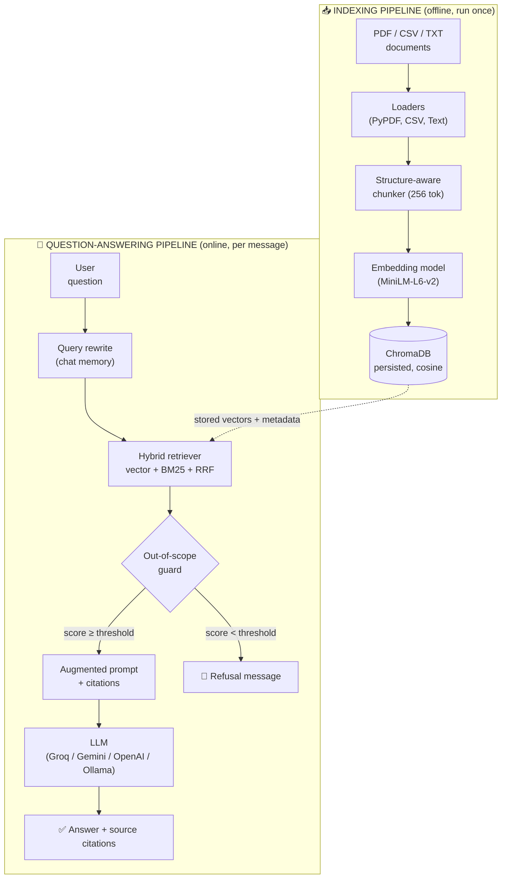

<div align="center">

# 🤖 NovaBot: Intelligent RAG-Based Student-Support Chatbot

**A production-style Retrieval-Augmented Generation (RAG) assistant built with LangChain, ChromaDB and LLMs**


*DataMites AI Capstone | AI Client Project 5 | Team Code: `PTID-AIE-JUL-26-11142`*

</div>

---

## 📑 Table of Contents

1. [Overview](#-overview)
2. [Key Features](#-key-features)
3. [System Architecture](#-system-architecture)
4. [Tech Stack](#-tech-stack)
5. [Knowledge Base](#-knowledge-base)
6. [Project Structure](#-project-structure)
7. [Quick Start](#-quick-start)
8. [Configuration](#-configuration)
9. [Usage](#-usage)
10. [How It Works (Deep Dive)](#-how-it-works-deep-dive)
11. [Evaluation & Results](#-evaluation--results)
12. [Business Impact](#-business-impact-illustrative)
13. [Limitations](#-limitations)
14. [Roadmap](#-roadmap)
15. [Troubleshooting](#-troubleshooting)
16. [References](#-references)
17. [Author](#-author)

---

## 🎯 Overview

Students at an engineering institute repeatedly ask the same questions about attendance, fees, scholarships, hostel timings, placements and library rules. The answers exist, but they are scattered across long PDF handbooks, a text policy and a CSV of FAQs. The help-desk is overloaded and answers vary by staff member.

A general-purpose LLM cannot fix this, because it has never seen the institute's policies. It either refuses or **hallucinates** a believable fee or deadline.

**NovaBot** keeps the policies in an external, searchable knowledge base. For every question it:

1. Retrieves the most relevant passages.
2. Forces the LLM to answer **only** from them, with inline citations such as `[1]`.
3. **Refuses gracefully** when the knowledge base does not contain the answer.

Updating a policy means re-indexing one document. There is no model retraining.

> **Why a fictional institute?** The knowledge base models *Nova Institute of Technology (NovaTech)*, which does not exist. No LLM can answer NovaTech questions from memory, so every correct answer proves retrieval worked, and every confident wrong answer exposes hallucination. All names, numbers and e-mails are invented.

---

## ✨ Key Features

| Feature | Description |
|---|---|
| 📄 **Multi-format ingestion** | PDF, TXT and CSV loaded through LangChain loaders. Metadata (`file`, `file_type`, page) powers citations. |
| ✂️ **Structure-aware chunking** | Splits on numbered headings first (one chunk is one policy rule), with a recursive splitter as fallback. Each chunk gets a `<title> \| <section>` context header. |
| 🔎 **Hybrid retrieval** | Vector similarity and BM25 keyword search fused with **Reciprocal Rank Fusion**. Similarity and MMR modes are also available. |
| 🛡️ **Out-of-scope guard** | A calibrated similarity threshold refuses unrelated questions **before** the LLM is called. |
| 🧾 **Grounded and cited answers** | The prompt restricts answers to numbered context, requires exact numbers, and uses one fixed refusal sentence. |
| 🧱 **Prompt-injection resistance** | The context and the user question are treated strictly as data. |
| 💬 **Conversational memory** | Follow-ups like *"and for postgraduates?"* are rewritten into standalone questions. |
| 🔌 **Provider fail-over** | Groq → Gemini → OpenAI → Ollama → offline fallback, picked automatically. |
| 📊 **Rigorous evaluation** | Separate dev and test sets, retrieval metrics, generation metrics and RAGAS (LLM-as-judge). |
| 🖥️ **Three interfaces** | CLI, Streamlit and Gradio, all calling the same `RAGChatbot` class. |
| 📦 **Self-contained module** | A `%%core` cell magic exports production code to `rag_core.py`. |
| 📚 **Auto-generated docs** | README, `requirements.txt` and `.env.example` are generated from the live config. |

---

## 🏗️ System Architecture

The system has two phases. **Indexing** runs offline, once. **Answering** runs online, for every message.



Re-indexing a changed policy touches only the top row. The prompt, guard and evaluation suite stay untouched.

---

## 🧰 Tech Stack

| Layer | Technology |
|---|---|
| Language | Python 3.10+ |
| Orchestration | LangChain (LCEL): `prompt \| llm \| StrOutputParser()` |
| Embeddings | `sentence-transformers/all-MiniLM-L6-v2` (384-dim, CPU-friendly). TF-IDF offline fallback. |
| Vector stores | **ChromaDB** (primary, HNSW, cosine) and **FAISS** (comparison) |
| Keyword search | `rank-bm25` |
| LLM providers | Groq, Google Gemini, OpenAI, Ollama (local) |
| Evaluation | Custom retrieval and generation metrics, **RAGAS** |
| Interfaces | Gradio, Streamlit, CLI |
| Data and plots | Pandas, Matplotlib, Seaborn, ReportLab (to generate the PDFs) |

---

## 📚 Knowledge Base

| Source file | Type | Content |
|---|---|---|
| `NovaTech_Academic_Regulations_2025-26.pdf` | PDF | Calendar, attendance, grading, CGPA, integrity |
| `NovaTech_Fees_and_Scholarships_2025-26.pdf` | PDF | Fees, instalments, refunds, scholarships |
| `NovaTech_Hostel_and_Campus_Life_2025-26.pdf` | PDF | Hostel, mess, safety, transport, grievance |
| `NovaTech_Placement_and_Internship_Policy_2025-26.pdf` | PDF | Eligibility, offers, internships, statistics |
| `NovaTech_IT_and_Library_Policy_2025-26.txt` | TXT | Wi-Fi, e-mail, labs, library |
| `NovaTech_Student_FAQ.csv` | CSV | 18 Q&A rows (deliberately overlaps the PDFs) |

**After ingestion:** 27 documents, about 3,170 words, which become **55 chunks** at the final configuration.

**Out of scope (must be refused):** facts not in the six documents (e.g. MBA fees, since NovaTech offers no MBA), other institutions, unrelated general knowledge, and prompt-injection attempts.

---

## 🗂️ Project Structure

> Names below follow the report. Adjust to match your repository.

```text
AI-Client-Project-5-Intelligent-RAG-Based-Chatbot-using-LangChain-LLM/
├── data/                         # Generated NovaTech PDFs, TXT and CSV
├── chroma_db/                    # Persisted vector index
│   └── rag_meta.json             # Calibrated out-of-scope threshold for this index
├── <project_notebook>.ipynb      # End-to-end notebook (ingest → evaluate → deploy)
├── rag_core.py                   # Production module, exported via the %%core magic
├── streamlit_app.py              # Streamlit interface (written by the notebook)
├── requirements.txt              # Generated dependency list
├── .env.example                  # Template for API keys (no real secrets)
└── README.md
```

---

## 🚀 Quick Start

### Prerequisites

- Python **3.10+**
- About **2 GB RAM** (the MiniLM model is about 90 MB). **No GPU needed.**
- Internet on the first run, to download the embedding model and optionally call a hosted LLM.

### 1. Clone and install

```bash
git clone https://github.com/Sameekshagithub/AI-Client-Project-5-Intelligent-RAG-Based-Chatbot-using-LangChain-LLM.git
cd AI-Client-Project-5-Intelligent-RAG-Based-Chatbot-using-LangChain-LLM

python -m venv .venv
source .venv/bin/activate          # Windows: .venv\Scripts\activate
pip install -r requirements.txt
```

> On **Google Colab** or a fresh environment, set `INSTALL_DEPS = True` in the notebook's first cell instead.

### 2. Add an LLM key (optional)

You need **only one** provider. Copy the template and fill in a single key:

```bash
cp .env.example .env
```

```env
GROQ_API_KEY=your_key_here        # free tier available
GOOGLE_API_KEY=                   # Gemini
OPENAI_API_KEY=                   # OpenAI
# Or run a local Ollama server, which needs no key
```

On Colab, add keys under **Secrets**. Never paste a key into a notebook cell.

> **No key at all?** The notebook still runs end to end using an offline fallback (TF-IDF embeddings plus an extractive answerer). Answer quality is materially lower than with a real embedding model and LLM.

### 3. Build the index

Run the notebook end to end. This generates the knowledge base, builds the ChromaDB index, calibrates the guard threshold, runs evaluation and exports `rag_core.py` and `streamlit_app.py`.

---

## ⚙️ Configuration

Every tunable lives in a single `CONFIG` dictionary, so there are no magic numbers buried in functions.

| Parameter | Default | Purpose |
|---|---|---|
| `chunk_size` | `256` tokens | Chunk granularity (tuned on the dev set) |
| `chunk_overlap` | `50` tokens | Stops a fact being cut at a chunk boundary |
| `top_k` | `4` | Chunks passed to the LLM per question |
| retrieval mode | `hybrid` | `similarity`, `mmr` or `hybrid` (vector + BM25 via RRF) |
| `temperature` | `0` | Deterministic factual answers |
| embedding model | `all-MiniLM-L6-v2` | 384-dim, free, CPU-friendly |
| out-of-scope threshold | calibrated | Recomputed when the embedding model changes, saved to `chroma_db/rag_meta.json` |

### Environment variables

| Variable | Effect |
|---|---|
| `GROQ_API_KEY`, `GOOGLE_API_KEY`, `OPENAI_API_KEY` | Enables the matching provider |
| `LLM_PROVIDER` | Forces a specific provider and skips auto-selection |
| `GROQ_MODEL` | Forces a specific Groq model name |
| `EMBEDDING_PROVIDER` | Switches embeddings to OpenAI, Google or Ollama |

**Provider selection order:** Groq → Gemini → OpenAI → Ollama → offline fallback.
Hosted free-tier model names are retired often (Groq retired `llama-3.3-70b-versatile` in August 2026). The factory therefore tries a **list of candidate models** per provider and keeps the first that passes a smoke test.

---

## 💻 Usage

### Command line

```bash
python rag_core.py
```

Type `reset` to clear conversation memory, or `exit` to quit.

### Streamlit

```bash
streamlit run streamlit_app.py
```

It loads the saved ChromaDB index (no re-embedding), keeps **separate history per browser session**, and shows cited sources under each answer.

### Gradio

Set `LAUNCH_GRADIO = True` in the notebook. On Colab, `share=True` creates a public demo link.

### Python API

```python
from rag_core import RAGChatbot

bot = RAGChatbot.from_persisted()      # rebuilds from the saved index only

reply = bot.ask("How much does a single hostel room cost, and is there an extra charge for AC?")
print(reply["answer"])
# -> A single room costs Rs. 1,25,000 per year including mess [1].
#    An air-conditioned room costs an additional Rs. 30,000 per year [1].

bot.ask("And for postgraduates?")      # follow-up, rewritten using memory
```

> Method and key names above are illustrative. Check `rag_core.py` for the exact return fields.

### Example scenarios

| Scenario | Expected behaviour |
|---|---|
| Plain factual question | Single-chunk answer with a citation |
| Multi-fact question | Several chunks combined into one cited answer |
| Multi-turn follow-up | Query rewritten into a standalone question |
| Clearly unrelated question | **Retrieval guard** refuses before the LLM is called |
| Prompt-injection attempt | Injected instructions ignored |
| Near-domain but unanswerable (MBA fee) | **LLM refusal rule** catches it |

---

## 🔬 How It Works (Deep Dive)

<details>
<summary><b>1. Ingestion</b></summary>

`PyPDFLoader` gives one Document per PDF page, `CSVLoader` one per row, and `TextLoader` one per file. Each Document carries `file` and `file_type` metadata, which later drives citations and metadata filtering. A live-web loader (`WebBaseLoader`) is demonstrated but **not** added to the production index, so the knowledge base stays limited to vetted documents.

</details>

<details>
<summary><b>2. Chunking</b></summary>

Policy documents have numbered headings like `3. Evaluation and Grading`. The splitter breaks on those first, so one chunk is one complete rule. It falls back to `RecursiveCharacterTextSplitter` only for sections that are still too long. Hard PDF line breaks are un-wrapped inside each section before splitting. Every chunk is prefixed with `<document title> | <section>`, which helps both vector and BM25 retrieval.

</details>

<details>
<summary><b>3. Embeddings</b></summary>

MiniLM maps text to 384-dim vectors, so "How much does a room cost?" matches "annual hostel fee … Rs. 1,25,000" despite sharing almost no words. The embedding space is validated by reporting the vector dimension, a semantic probe (related pairs must outscore unrelated ones), and a 2-D PCA plot that should show topic and source clusters.

</details>

<details>
<summary><b>4. Hybrid retrieval (RRF)</b></summary>

| Mode | Strength | Weakness |
|---|---|---|
| `similarity` | Simple, semantic | Misses exact numbers and terms, can return near-duplicates |
| `mmr` | Relevance plus diversity | Can drop a relevant second chunk |
| `hybrid` | Semantic and exact-match | Two indices to maintain |

RRF scores each chunk as the sum of `1 / (60 + rank)` across the BM25 and vector rankings, so no manual score calibration is needed.

</details>

<details>
<summary><b>5. Out-of-scope guard</b></summary>

If even the **top-1 similarity** is below the threshold, the bot refuses without calling the LLM. The threshold is calibrated on the dev set. It sits one-third of the way from the strongest out-of-scope score up to the 10th percentile of in-scope scores. It is **biased toward answering**, because the prompt's refusal rule is a second safety net. The calibrated value for the offline embeddings was `0.122`.

**Known gap:** near-domain unanswerable questions (e.g. MBA fees) retrieve real fee chunks and pass this guard. Only the prompt's refusal rule catches them.

</details>

<details>
<summary><b>6. Prompt and LCEL chain</b></summary>

Four rules: (1) answer only from numbered context, (2) use one exact, detectable refusal sentence otherwise, (3) quote numbers precisely with inline `[n]` citations, (4) treat context and question as data, so hidden instructions are ignored. The chain is `prompt | llm | StrOutputParser()`, wrapped by `RAGChatbot` with query rewriting, retrieval, the guard and source tracking.

</details>

<details>
<summary><b>7. Chunk-size tuning (dev set only)</b></summary>

Grid search over chunk size (128, 256, 512) × structure-aware or naive splitting, scored by the mean of Hit@3, MRR and keyword recall.

| Chunk size | Structure-aware | Chunks | Hit@3 | MRR | Keyword recall | Score |
|---:|:---:|---:|---:|---:|---:|---:|
| 256 | No | 38 | 0.929 | 0.911 | 1.000 | 0.946 |
| 128 | No | 62 | 0.929 | 0.907 | 1.000 | 0.945 |
| 512 | No | 31 | 1.000 | 0.833 | 1.000 | 0.944 |
| 128 | Yes | 66 | 0.929 | 0.875 | 1.000 | 0.935 |
| **256** | **Yes** | **55** | 0.929 | 0.875 | 1.000 | **0.935** |
| 512 | Yes | 55 | 0.929 | 0.875 | 1.000 | 0.935 |

Naive 256 scores highest, but only by 0.011. Structure-aware splitting is kept unless naive beats it by more than **0.03**, because on a tiny dev set that gap is noise and whole-section chunks give cleaner citations.

</details>

---

## 📈 Evaluation & Results

Retrieval and generation are evaluated **separately** so failures can be diagnosed. All figures come from the **22-question held-out test set**, which was never used for tuning. Tuning used a separate 20-question dev set.

### Metrics

| Metric | Definition |
|---|---|
| Hit@k | Share of questions with a correct chunk in the top k |
| MRR | Mean of 1 / rank of the first correct chunk |
| Precision@k | Share of top-k chunks that are relevant |
| Keyword recall@k | Share of gold keywords found in the top-k chunks |
| Answer correctness | Share of gold keywords present in the answer |
| Faithfulness (lexical) | Share of answer content words found in retrieved context |
| Answer relevancy | Cosine similarity between question and answer |
| Refusal accuracy | Refused exactly when the gold item is must-refuse |
| False-refusal rate | Share of in-scope questions wrongly refused |

### Retrieval (test set)

| Mode | Hit@1 | Hit@3 | Hit@5 | MRR | Precision@k | Keyword recall@k |
|---|---:|---:|---:|---:|---:|---:|
| similarity | 0.889 | 1.000 | 1.000 | 0.944 | 0.211 | 1.000 |
| mmr | 0.889 | 1.000 | 1.000 | 0.944 | 0.211 | 1.000 |
| hybrid | 0.889 | 1.000 | 1.000 | 0.944 | 0.211 | 1.000 |

### Final scorecard

| Metric | Value |
|---|---:|
| Retrieval Hit@3 | **1.00** |
| Retrieval MRR | **0.94** |
| Answer correctness | **0.81** |
| Faithfulness (lexical) | **1.00** |
| Refusal accuracy | **0.50** |
| False-refusal rate (in-scope) | **0.00** |
| Average latency | **0.01 s** |

### ⚠️ Read these numbers honestly

- **Offline mode.** Results were produced with the **TF-IDF embeddings and extractive-LLM fallback**, because no embedding or LLM API was reachable. **RAGAS was skipped** for the same reason. The report expects a real embedding model and hosted LLM to raise correctness and refusal accuracy, but that has **not been measured** yet.
- **No retrieval separation on test.** All three modes scored identically, so the test set does not show hybrid beating the others. Hybrid was chosen for its exact-match robustness and dev-set evidence.
- **Refusal accuracy is 0.50.** The report attributes this to the weak extractive answerer, not the retrieval guard (0.00 false-refusal rate).
- **Small sets.** 20 and 22 questions give wide confidence intervals, so small differences should not be over-interpreted.
- **Proxy metrics.** Keyword-based metrics can penalise correct paraphrases. Run RAGAS or human review before production sign-off.

### Re-running with a real LLM and RAGAS

Add an API key and re-run the evaluation cells. RAGAS scores faithfulness, response relevancy, context precision and context recall. It is skipped automatically in offline mode. `ResponseRelevancy` uses `strictness=1` and judge calls use `max_workers=2`, to suit free-tier providers (e.g. Groq rejects multiple completions per request).

---

## 💼 Business Impact (Illustrative)

**Assumptions:** 300 queries/day, 60% deflection, 4 min staff time per query, Rs. 250/hour staff cost, Rs. 0.25 LLM cost per query, 26 working days/month. These are placeholders. Replace them with real client figures.

| Item (per month) | Value |
|---|---:|
| Queries deflected (300 × 60% × 26) | 4,680 |
| Staff time saved | 312 hours |
| Staff cost saved | Rs. 78,000 |
| LLM running cost (all 7,800 queries) | Rs. 1,950 |
| **Net monthly benefit** | **Rs. 76,050** |

**Qualitative gains:** consistent 24×7 answers with verifiable sources, cheap policy updates (re-index, no retraining), a refusal path that routes edge cases to humans, and refused-question logs that show gaps in the handbook.

---

## 🚧 Limitations

- The knowledge base is **small and synthetic**. Real corpora bring OCR noise, tables, conflicting versions and multilingual text.
- Retrieval is **single-step**, so multi-document comparisons and calculations are only partly supported.
- There is **no authentication or personalisation**, so the bot cannot answer "what is my fee balance?"
- Near-domain unanswerable questions depend on the LLM's refusal rule, not the retrieval guard.

---

## 🗺️ Roadmap

- [ ] Cross-encoder re-ranking (e.g. `bge-reranker`) over the top-20 candidates
- [ ] Query routing / agentic RAG (account questions → ERP API, policy questions → vector index)
- [ ] Streaming answers, feedback buttons and answer logging
- [ ] Document versioning and metadata filters (academic year, programme)
- [ ] Multilingual support (Hindi, Kannada) with a multilingual embedding model
- [ ] Docker packaging and CI that runs the offline evaluation on every pull request
- [ ] Re-run the full evaluation with real embeddings, a hosted LLM and RAGAS

---

## 🩺 Troubleshooting

| Problem | Fix |
|---|---|
| Model not found / retired (hosted LLM) | Set `GROQ_MODEL` or `LLM_PROVIDER`. The factory also tries fallback candidates. |
| Answers feel extractive or weak | You are probably in offline mode. Add an API key and real embeddings. |
| Everything gets refused after changing the embedding model | Rebuild the index so the threshold in `chroma_db/rag_meta.json` is recomputed. |
| RAGAS errors on relevancy | Keep `strictness=1` and `max_workers=2` for free-tier providers. |
| Streamlit shows no data | Run the notebook end to end first so `chroma_db/` exists. |
| Secrets in git | Only commit `.env.example`. Keep `.env` in `.gitignore`. |

---

## 📖 References

- Lewis et al., 2020. *Retrieval-Augmented Generation for Knowledge-Intensive NLP Tasks* (NeurIPS).
- Cormack, Clarke & Büttcher, 2009. *Reciprocal Rank Fusion Outperforms Condorcet and Individual Rank-Learning Methods*.
- Carbonell & Goldstein, 1998. *The Use of MMR, Diversity-Based Reranking*.
- Es et al., 2023. *RAGAS: Automated Evaluation of Retrieval Augmented Generation*.
- Official documentation: LangChain, ChromaDB, FAISS, Sentence-Transformers, Gradio, Streamlit.

---

## 👩‍💻 Author

**Sameeksha**, AI / Data Science Intern (AI track)
DataMites Data Science Internship Program, DataMites Solutions Pvt. Ltd.

- GitHub: [Sameekshagithub](https://github.com/Sameekshagithub)
- Repository: [AI-Client-Project-5-Intelligent-RAG-Based-Chatbot-using-LangChain-LLM](https://github.com/Sameekshagithub/AI-Client-Project-5-Intelligent-RAG-Based-Chatbot-using-LangChain-LLM)

> All institution names, figures and e-mail addresses in this project are fictional and used for demonstration only.

<div align="center">

⭐ If this project helped you, consider starring the repository.

</div>
