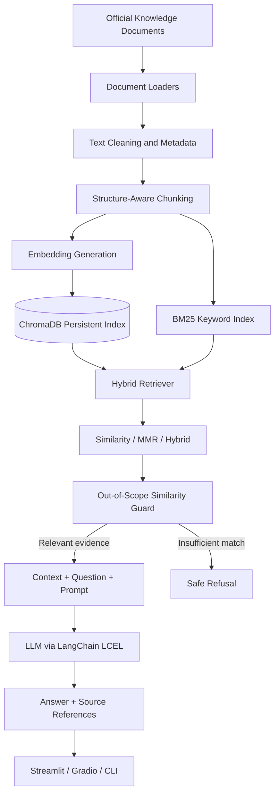

::: {align="center"}
# 🤖 NovaBot

### Intelligent, Grounded RAG Chatbot for Student Policy & Institutional Queries

**Ask questions in natural language. Retrieve answers from trusted
documents. Verify every response with source citations.**

[](https://www.python.org/)
[](https://www.langchain.com/)
[](https://www.trychroma.com/)
[](https://github.com/facebookresearch/faiss)
[](https://streamlit.io/)
[](https://www.gradio.app/)
:::

------------------------------------------------------------------------

## 📌 Project Overview

**NovaBot** is a Retrieval-Augmented Generation (RAG) chatbot designed
to answer student questions using an institution's official documents
rather than relying only on an LLM's pre-trained knowledge. It ingests
PDF, CSV and TXT/Markdown files, converts their content into searchable
chunks, retrieves relevant evidence, and generates a concise response
with source references.

The project focuses on the complete RAG lifecycle: document ingestion,
structure-aware chunking, embeddings, persistent vector indexing, hybrid
retrieval, grounded generation, conversational follow-up handling,
refusal logic, evaluation and multiple interfaces.

> **Core principle:** If the supplied knowledge base does not contain
> enough evidence, NovaBot is designed to say so instead of inventing an
> answer.

## ✨ Key Features

  -----------------------------------------------------------------------
  Capability                          Implementation
  ----------------------------------- -----------------------------------
  Multi-format knowledge ingestion    PDF, CSV, TXT and Markdown document
                                      loaders

  Structure-aware chunking            Splits around numbered policy
                                      headings, then applies recursive
                                      splitting

  Context-enriched chunks             Adds document/section context to
                                      improve retrieval

  Configurable embeddings             Hugging Face, OpenAI, Google,
                                      Ollama and offline TF-IDF fallback

  Persistent vector database          ChromaDB with cosine-distance
                                      retrieval and metadata

  Vector-store comparison             FAISS index built and measured
                                      alongside ChromaDB

  Multiple retrieval strategies       Similarity, Maximal Marginal
                                      Relevance (MMR), and hybrid
                                      retrieval

  Hybrid search                       BM25 keyword retrieval + dense
                                      vector retrieval + Reciprocal Rank
                                      Fusion

  Conversational follow-ups           Rewrites follow-up questions using
                                      conversation history

  Grounded answers                    Prompt restricts answers to
                                      retrieved context and requests
                                      inline source citations

  Hallucination safeguards            Similarity-based out-of-scope guard
                                      and model-level refusal instruction

  Prompt-injection resistance         Treats retrieved context and user
                                      questions as data, not trusted
                                      instructions

  Evaluation framework                Retrieval metrics, generation
                                      proxies, error analysis and
                                      optional RAGAS

  Multiple interfaces                 Streamlit, Gradio and command-line
                                      interface

  Reproducibility                     Exports reusable `rag_core.py` and
                                      reloads persisted indexes in a
                                      fresh process
  -----------------------------------------------------------------------

## 🏗️ System Architecture



### End-to-end workflow

1.  **Ingest:** Load PDF pages, CSV rows and text/Markdown files with
    source metadata.
2.  **Clean:** Un-wrap hard line breaks in extracted PDF text while
    preserving numbered headings.
3.  **Chunk:** Split documents by numbered sections before recursive
    splitting; use overlap to reduce boundary loss.
4.  **Embed:** Convert chunks into vectors using the configured
    embedding provider.
5.  **Index:** Persist vectors and metadata in ChromaDB; build a FAISS
    comparison index.
6.  **Retrieve:** Select similarity, MMR or hybrid BM25 + vector
    retrieval.
7.  **Guard:** Check the strongest vector similarity against a
    calibrated threshold for unrelated questions.
8.  **Generate:** Pass retrieved context and the standalone question to
    the LangChain prompt/LLM chain.
9.  **Respond:** Return the answer, cited sources and retrieval
    information; preserve conversational context for follow-ups.

## 🔎 Retrieval Strategies

NovaBot exposes three retrieval modes through a common retriever
interface.

  -----------------------------------------------------------------------
  Mode                    How it works            When it helps
  ----------------------- ----------------------- -----------------------
  `similarity`            Retrieves the nearest   Semantically similar
                          vector matches          questions

  `mmr`                   Uses Maximal Marginal   Reducing repetitive or
                          Relevance to balance    near-duplicate chunks
                          relevance and diversity 

  `hybrid`                Combines BM25 keyword   Queries involving exact
                          ranking and dense       terms, names, codes,
                          vector ranking using    fees or numbers
                          Reciprocal Rank Fusion  
                          (RRF)                   
  -----------------------------------------------------------------------

**Reciprocal Rank Fusion** combines ranked results without requiring the
BM25 and vector scores to share the same scale. The implementation uses
the standard rank-fusion form:

\[ RRF(d)=`\sum`{=tex}\_{r
`\in `{=tex}rankings}`\frac{1}{60+rank_r(d)}`{=tex} \]

The hybrid retriever returns the selected chunks and the best vector
similarity score, which is also used by the out-of-scope guard.

## 🛡️ Grounding, Safety and Refusal Behaviour

NovaBot uses more than one layer to reduce unsupported responses:

-   **Context-restricted prompt:** The model is instructed to answer
    using the retrieved numbered context.
-   **Source references:** The answer format requests inline citations
    that map back to retrieved source chunks.
-   **Similarity guard:** If the strongest vector match is below a
    threshold calibrated using the development set, the chatbot can
    refuse before calling the LLM.
-   **Model-level refusal:** The prompt defines a consistent refusal
    response for questions that cannot be answered from the available
    documents.
-   **Prompt-injection handling:** Retrieved text and the user question
    are treated as data; instructions embedded in them should not
    override the system prompt.
-   **Near-domain questions:** A question can be related to
    institutional policies but still lack an answer in the documents.
    These cases are handled by the generation prompt and tested
    separately.

The similarity guard is intended for clearly unrelated queries; it is
not a guarantee that every retrieved chunk contains the requested fact.
Evaluation and error analysis are therefore important.

## 🧪 Evaluation Framework

The notebook separates **retrieval quality** from **answer-generation
quality**, making it easier to identify where a failure occurs.

### Dataset split

-   **Development set:** 20 questions used for tuning chunk size,
    retrieval mode and the out-of-scope threshold.
-   **Held-out test set:** 22 questions reserved for final evaluation
    and not used for tuning.
-   Test cases include in-scope questions, out-of-scope questions, a
    near-domain but unanswered question, a numeric question and a
    prompt-injection attempt.

### Retrieval metrics

  -----------------------------------------------------------------------
  Metric                              What it measures
  ----------------------------------- -----------------------------------
  Hit@k                               Whether at least one relevant chunk
                                      appears in the top-k results

  MRR                                 How highly the first relevant chunk
                                      is ranked

  Precision@k                         Fraction of retrieved top-k chunks
                                      considered relevant

  Keyword recall@k                    Fraction of required answer
                                      keywords present in retrieved
                                      chunks
  -----------------------------------------------------------------------

### Generation metrics

The notebook calculates transparent offline proxies:

-   **Answer correctness (keyword):** Presence of required gold keywords
    in the generated answer.
-   **Faithfulness (lexical):** Degree to which answer content words
    appear in retrieved context.
-   **Answer relevancy (embedding):** Semantic similarity between the
    question and answer.
-   **Refusal accuracy:** Whether questions requiring refusal are
    refused.
-   **False-refusal rate:** How often valid in-scope questions are
    incorrectly refused.

### RAGAS evaluation

When a real LLM and the required dependencies are available, the
notebook can additionally run RAGAS metrics:

-   Faithfulness
-   Response relevancy
-   Context precision
-   Context recall

RAGAS is skipped in offline fallback mode because the extractive
fallback is not a suitable judge model.

> **Reporting note:** Add the actual scorecard values produced by your
> own notebook run here before publishing. Scores depend on the selected
> embedding/LLM providers and the current configuration; this README
> intentionally does not invent benchmark results.

## 🧰 Technology Stack

  -----------------------------------------------------------------------
  Area                                Tools / Libraries
  ----------------------------------- -----------------------------------
  Language                            Python

  Notebook environment                Jupyter Notebook / Google Colab

  LLM orchestration                   LangChain, LangChain Expression
                                      Language (LCEL)

  Embeddings                          Sentence-Transformers / Hugging
                                      Face, OpenAI, Google, Ollama,
                                      TF-IDF fallback

  Vector stores                       ChromaDB, FAISS

  Keyword retrieval                   BM25 (`rank_bm25`)

  Document processing                 PyPDF, LangChain document loaders,
                                      CSV and text loaders

  Text splitting                      Recursive Character Text Splitter

  Interfaces                          Streamlit, Gradio, CLI

  Evaluation                          scikit-learn-style metrics
                                      implemented in the notebook, RAGAS
                                      (optional)

  Visualization / analysis            NumPy, pandas, Matplotlib and
                                      supporting Python libraries
  -----------------------------------------------------------------------

## 📂 Project Structure

The notebook generates or uses the following project artefacts:

``` text
NovaBot/
│
├── AI_Client_Project_5_RAG_Chatbot.ipynb
├── rag_core.py                 # Reusable RAG pipeline and chatbot logic
├── streamlit_app.py            # Streamlit application
├── requirements.txt            # Python dependencies
├── .env.example                # Environment-variable template
├── README.md
│
├── data/                       # PDF, CSV, TXT and Markdown knowledge files
├── chroma_db/                  # Persistent ChromaDB collection and metadata
├── faiss_index/                # Saved FAISS comparison index
└── architecture.png            # Architecture diagram (if generated)
```

Generated artefacts depend on which notebook cells have been executed.
Keep API keys and private institutional documents out of public
repositories.

## ⚙️ Installation and Setup

### 1. Clone the repository

``` bash
git clone https://github.com/Sameekshagithub/AI-Client-Project-5-Intelligent-RAG-Based-Chatbot-using-LangChain-LLM.git
cd AI-Client-Project-5-Intelligent-RAG-Based-Chatbot-using-LangChain-LLM
```

### 2. Create and activate a virtual environment

``` bash
python -m venv .venv

# Windows
.venv\Scripts\activate

# macOS / Linux
source .venv/bin/activate
```

### 3. Install dependencies

``` bash
pip install -r requirements.txt
```

If you are working directly in Jupyter, install the notebook
dependencies in the active kernel environment.

### 4. Configure environment variables

Copy `.env.example` to `.env` and add the API key for the provider you
intend to use. Do not commit `.env`.

``` env
GROQ_API_KEY=
GOOGLE_API_KEY=
OPENAI_API_KEY=

# Optional provider overrides
# LLM_PROVIDER=groq
# EMBEDDING_PROVIDER=huggingface
# GROQ_MODEL=openai/gpt-oss-120b
# GEMINI_MODEL=gemini-2.5-flash
# OPENAI_MODEL=gpt-4o-mini
# OLLAMA_MODEL=mistral
```

The notebook supports automatic provider selection and fallback
behaviour. Exact model availability depends on provider credentials,
installed integrations and provider-side model availability.

### 5. Add knowledge-base documents

Place supported source documents in the `data/` directory:

-   `.pdf`
-   `.csv`
-   `.txt`
-   `.md`

The notebook's demonstration knowledge base contains sample NovaTech
institutional documents. Replace or supplement these with documents you
are authorized to use.

### 6. Run the notebook

Open `AI_Client_Project_5_RAG_Chatbot.ipynb` in Jupyter Notebook or
Google Colab and execute the cells from top to bottom. The notebook
prepares the knowledge base, evaluates retrieval choices, builds the
vector stores and exports the reusable application files.

## ▶️ Running the Applications

### Streamlit

``` bash
streamlit run streamlit_app.py
```

The Streamlit interface provides a browser-based chat experience,
retrieval-mode selection, a top-k control and source references under
responses. Conversation state is maintained per browser session.

### Command-line interface

``` bash
python rag_core.py
```

### Gradio

The notebook includes a Gradio chat interface. Enable the notebook's
`LAUNCH_GRADIO` setting and run the relevant cell to launch it. A
shareable link can be enabled in Colab for demonstration purposes; use
care before exposing private data.

## 🔧 Configuration

The notebook centralizes runtime settings in its configuration object
and supports provider overrides through environment variables.

  -----------------------------------------------------------------------
  Setting                             Purpose
  ----------------------------------- -----------------------------------
  `LLM_PROVIDER`                      Selects `auto`, `groq`, `gemini`,
                                      `openai`, `ollama` or `offline`

  `EMBEDDING_PROVIDER`                Selects `auto`, `huggingface`,
                                      `openai`, `google` or `ollama`

  `CONFIG`                            Holds retrieval, chunking,
                                      persistence and model settings

  Retrieval mode                      Chooses `similarity`, `mmr` or
                                      `hybrid`

  Top-k                               Controls the number of chunks
                                      returned to the answer chain

  Data directory                      Location of source knowledge
                                      documents

  Persistence directory               Location of the ChromaDB index and
                                      metadata
  -----------------------------------------------------------------------

The provider factories perform connectivity checks and can fall back to
offline implementations. The offline TF-IDF embedding and extractive
chat implementations are intended to make the pipeline testable without
external API access; they are not equivalent to neural embeddings or a
generative LLM.

## 🔁 Rebuilding and Reusing the Knowledge Base

When source documents change:

1.  Add, replace or remove files in `data/`.
2.  Set the notebook's knowledge-base regeneration option as
    appropriate.
3.  Re-run document loading, chunking, embedding and indexing cells.
4.  Confirm the new index metadata and document count.
5.  Run the retrieval and chatbot tests again.

The notebook assigns stable, human-readable chunk IDs and stores
metadata for the persistent ChromaDB index. The exported
`RAGChatbot.from_persisted()` method is used by the interfaces to reopen
the saved index without rebuilding embeddings on every app start.

## 💡 Engineering Decisions and Challenges

  -----------------------------------------------------------------------
  Challenge                           Approach in this project
  ----------------------------------- -----------------------------------
  PDF extraction creates broken line  Re-joins wrapped lines while
  wraps                               retaining numbered headings

  Fixed-size chunks mix unrelated     Splits around numbered headings
  policy sections                     before recursive chunking

  Exact terms and numeric facts can   Combines BM25 and vector rankings
  be missed by semantic search        using RRF

  Similar chunks can dominate results Provides MMR as a
                                      diversity-oriented retrieval option

  Irrelevant questions can trigger    Calibrated similarity threshold and
  unsupported answers                 model-level refusal

  Provider model names can change     Candidate model list, connectivity
                                      smoke tests and environment
                                      overrides

  Test scores can be inflated by      Uses separate development and
  tuning on test data                 held-out test question sets

  Notebook-only code is difficult to  Exports a reusable `rag_core.py`
  deploy                              module and application interfaces

  Index persistence must be verified  Reopens the stored index and checks
                                      retrieval in a fresh process
  -----------------------------------------------------------------------

## ⚠️ Limitations

-   Answer quality depends on the completeness, freshness and quality of
    the documents in the knowledge base.
-   Retrieval similarity is a heuristic and cannot prove that a chunk
    contains the complete answer.
-   Offline TF-IDF and extractive fallbacks are for pipeline testing,
    not production-quality semantic understanding or generation.
-   RAGAS requires a functioning judge LLM and suitable provider
    configuration.
-   API rate limits, model deprecations, network availability and
    provider costs can affect hosted inference.
-   The included NovaTech content is a demonstration knowledge base; it
    must be replaced with verified, authorized documents for real
    institutional use.
-   This project is a document-grounded information assistant, not a
    substitute for official decisions or human support.

## 🚀 Future Enhancements

-   Add authentication and role-based access for students, faculty and
    administrators.
-   Add document versioning, scheduled re-indexing and change detection.
-   Introduce richer source previews with page-level PDF citations.
-   Add multilingual question answering and speech-to-text /
    text-to-speech.
-   Add feedback collection and an unanswered-question dashboard.
-   Add automated regression tests for retrieval, citations, refusals
    and prompt-injection cases.
-   Add production monitoring for latency, token usage, retrieval
    quality and cost.
-   Deploy with containerization and a managed vector database when
    scale requires it.

## 👩‍💻 Author

**Sameeksha Rai**\
AI/ML Engineer \| Data Scientist \| Generative AI Enthusiast

-   GitHub: [@Sameekshagithub](https://github.com/Sameekshagithub)

## 📚 References

-   Lewis et al. (2020), *Retrieval-Augmented Generation for
    Knowledge-Intensive NLP Tasks*.
-   Cormack, Clarke & Büttcher (2009), *Reciprocal Rank Fusion
    outperforms Condorcet and individual rank-learning methods*.
-   Carbonell & Goldstein (1998), *The Use of MMR, Diversity-Based
    Reranking for Reordering Documents and Producing Summaries*.
-   Es et al. (2023), *RAGAS: Automated Evaluation of Retrieval
    Augmented Generation*.
-   [LangChain Documentation](https://python.langchain.com/)
-   [ChromaDB Documentation](https://docs.trychroma.com/)
-   [FAISS](https://github.com/facebookresearch/faiss)
-   [Sentence-Transformers](https://www.sbert.net/)
-   [Streamlit Documentation](https://docs.streamlit.io/)
-   [Gradio Documentation](https://www.gradio.app/docs)

------------------------------------------------------------------------

::: {align="center"}
**Built with Python, LangChain, Retrieval-Augmented Generation and a
focus on trustworthy answers.**
:::
