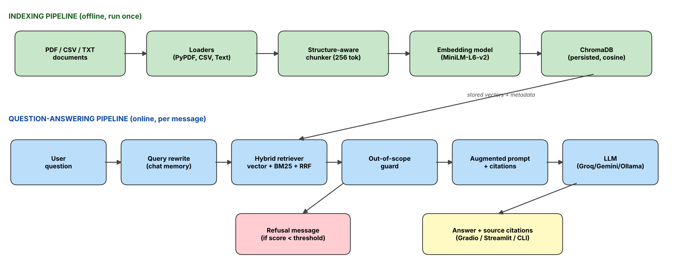

# 🎓 NovaBot — RAG Student-Support Chatbot (Streamlit + LangChain + ChromaDB)

A complete, runnable Retrieval-Augmented Generation chatbot. It answers questions **only from your documents**, shows the
**sources** it used, **refuses** when the answer isn't in the documents, and remembers the conversation for follow-ups.
The sample knowledge base is a *fictional* institute (Nova Institute of Technology), so every correct answer proves
retrieval works. Replace it with your own PDFs in two clicks.



## Features
| | |
|---|---|
| **Chat UI** | Streamlit app with sample questions, streaming answers, source cards with highlighted matches, 👍/👎 feedback, transcript download |
| **Knowledge-base page** | file/chunk stats, chunk explorer, **retrieval playground** (vector vs BM25 vs hybrid) |
| **Evaluation page** | one-click Hit@k / MRR / correctness / faithfulness / refusal accuracy on 22 held-out questions |
| **Retrieval** | structure-aware chunks with context headers · ChromaDB (cosine) · BM25 + vector fused by Reciprocal Rank Fusion · MMR |
| **Safety** | calibrated out-of-scope threshold · strict grounded prompt with exact refusal sentence · prompt-injection resistant |
| **Providers** | LLM auto-detected: Groq → Gemini → OpenAI → local Ollama → offline demo mode. Embeddings: sentence-transformers → OpenAI → Google → offline TF-IDF |
| **Add documents** | upload PDF / CSV / TXT in the sidebar → *Save & re-index* |

## Quick start (VS Code)
1. **Install** Python 3.10+ and VS Code (the *Python* and *Pylance* extensions are suggested automatically).
2. **Open the folder:** `File → Open Folder… → novabot-rag`.
3. **Create the environment** (VS Code terminal):
   ```bash
   python -m venv .venv
   # macOS/Linux: source .venv/bin/activate        Windows: .venv\Scripts\activate
   pip install -r requirements.txt
   ```
   Then `Ctrl+Shift+P → Python: Select Interpreter → .venv`.
4. **Add an LLM key (recommended, free):** copy `.env.example` to `.env` and paste a `GROQ_API_KEY`
   from <https://console.groq.com>. Without a key the app still runs in *offline demo mode*.
5. **Run:** press **F5** and choose **"NovaBot: Streamlit app"**, or in the terminal:
   ```bash
   streamlit run app.py
   ```
   The browser opens at <http://localhost:8501>. The first start builds the index (it downloads a ~90 MB embedding model once).

One-command alternative: `./run.sh` (macOS/Linux) or `run.bat` (Windows).

## Project layout
```
app.py               Streamlit front-end (Chat · Knowledge base · Evaluation · About)
rag_core.py          RAG engine: chunking, embeddings, ChromaDB, hybrid retriever, prompt, RAGChatbot, provider factories
pipeline.py          Builds / rebuilds the index and calibrates the out-of-scope threshold
evaluation.py        Retrieval + generation metrics (also: python evaluation.py)
eval_data.py         Gold question sets: DEV_SET (tuning) and TEST_SET (held-out)
kb_data.py           Text of the sample knowledge base
make_sample_data.py  Writes the sample PDF/TXT/CSV files into data/
data/                Your documents (sample files included)
chroma_db/           Persistent vector index (created automatically; delete it to force a rebuild)
tests/               pytest smoke tests
.vscode/             launch (F5) configs, tasks, settings
.streamlit/          theme and server config
```

## Commands
| Task | Command | VS Code |
|---|---|---|
| Run the app | `streamlit run app.py` | F5 → *Streamlit app* |
| Rebuild the index | `python pipeline.py` | F5 → *Build / rebuild index* |
| Evaluate | `python evaluation.py` | F5 → *Evaluate* |
| Terminal chat | `python rag_core.py` | F5 → *Command-line chat* |
| Tests | `pytest -q` | Testing panel |

## Use your own documents
1. Put PDF / CSV / TXT files in `data/` (delete the sample files if you don't want them) **or** use the sidebar uploader.
2. Click **Re-index** (or run `python pipeline.py`).
3. Change the bot's wording: `SYSTEM_PROMPT` and `REFUSAL` in `rag_core.py`, and the title/samples in `app.py`.
4. For custom documents the out-of-scope threshold starts at a default; tune it with the sidebar slider
   (use the **Retrieval playground** to see typical scores for good and bad queries).
5. Numbered headings such as `3. Evaluation and Grading` give the best chunks; for other layouts adapt `HEADING_RE` in `rag_core.py`.
   `eval_data.py` only applies to the sample knowledge base — write your own questions for your documents.

## Configuration (`.env`)
| Variable | Meaning |
|---|---|
| `GROQ_API_KEY` / `GOOGLE_API_KEY` / `OPENAI_API_KEY` | any one enables a real LLM |
| `LLM_PROVIDER` | `auto` (default) · `groq` · `gemini` · `openai` · `ollama` · `offline` |
| `GROQ_MODEL`, `GEMINI_MODEL`, `OPENAI_MODEL`, `OLLAMA_MODEL` | override the model name (hosted model names get retired — the app tries several automatically) |
| `EMBEDDING_PROVIDER` | `auto` · `huggingface` · `openai` · `google` · `ollama` |

Chunk size, overlap, top-k and retrieval mode live in `CONFIG` at the top of `rag_core.py`.
**After changing embeddings or chunking, rebuild the index** (`python pipeline.py`).

## Troubleshooting
| Problem | Fix |
|---|---|
| Banner says *offline demo mode* | No key found. Check `.env` has a value (no quotes/spaces) and restart Streamlit. |
| Embedding model download fails | Check internet/proxy, or set `EMBEDDING_PROVIDER=openai`. A TF-IDF fall-back is used automatically (lower quality). |
| Changed documents but answers unchanged | Click *Re-index* or delete `chroma_db/`. |
| Good questions get refused | Lower the *Out-of-scope threshold* slider. Unrelated questions get answered → raise it. |
| `ModuleNotFoundError` | The venv isn't active / the interpreter isn't selected in VS Code. |
| Port already in use | `streamlit run app.py --server.port 8502` |

## Notes & limitations
* All institute names, numbers and contacts in the sample data are **fictional**.
* Offline demo mode extracts sentences instead of generating answers; use a real LLM for production-quality results.
* Scores on the Evaluation page depend on the embedding model and LLM in use. The 22-question test set is small — treat
  differences of a few points as noise.
* Feedback clicks are stored locally in `logs/feedback.jsonl`.
